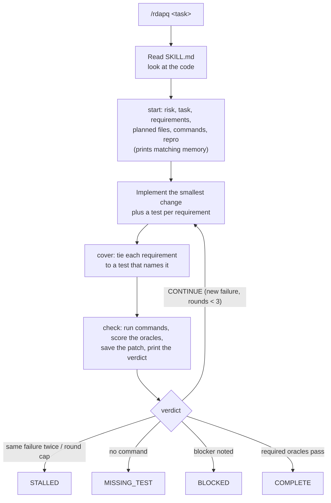

# RDAP-Q: Research-Driven Adaptive Planning with Quality Gates

[](https://github.com/actviteai/rdapq/actions/workflows/ci.yml)
[](https://www.gnu.org/licenses/gpl-3.0)
[](https://github.com/actviteai/rdapq)
[](https://www.npmjs.com/package/@actvite/rdapq)

Harnesses: Cursor, OpenAI Codex, Claude Code, GitHub Copilot, Grok Build, Google Antigravity, Block Goose, Cline, and Nous Research Hermes Agent. Framework: NVIDIA NeMo Agent Toolkit. See [Install](#install).

---

## <a id="description"></a> Description

> **RDAP-Q: Research-Driven Adaptive Planning with Quality Gates** — an evidence-first protocol and skill for AI coding agents in **Codex, Grok, Copilot, Antigravity, Goose, Claude, Cline, Cursor, and Hermes Agent**. A bundled tool runs the checks and names the result, so the model never grades its own work.

This GitHub tree is protocol **2.0.0**. It is on `main` and is not published to npm: the 2.0 eval ship gate did not pass, so there is no `@actvite/rdapq@2.0.0` registry package and no `v2.0.0` git tag. Releases publish as [`@actvite/rdapq`](https://www.npmjs.com/package/@actvite/rdapq), which has no release yet. The 1.x protocol is the legacy unscoped package `rdap-q`, last released as **1.4.0**. <!-- keep-version -->

---

## <a id="overview"></a> Overview

Coding agents often say "done" when they are not. They grade their own work, and a self-grade is an opinion. RDAP-Q moves that decision into code: **the model proposes, the tool decides.**

The agent reads `SKILL.md` (about 1.5k tokens), plans the change, and then drives `tool/rdapq.js`, a zero-dependency Node script that ships inside the skill:

| Step | Command | What the tool does |
| :--- | :--- | :--- |
| Plan | `start --risk LOW --task "<request>" --req "<clause>" --files a,b --run "npm test"` | Records what "done" means: risk, the request, its requirement clauses, planned files, required commands, optional repro. |
| Prove the bug | `check --before` | Runs the repro so the fix can be shown to change it from failing to passing. |
| Cover | `cover R1 test/a.test.js "<test name>"` | Ties each requirement to a test that exists and names it. |
| Measure and decide | `check` | Runs the commands, scores six oracles, saves the round's patch, and prints the verdict. COMPLETE only when every required oracle passes. `gate` reprints it. |

| Problem in typical agents | What RDAP-Q does |
| :--- | :--- |
| "Done" with failing or missing tests | `gate` refuses COMPLETE unless the required commands ran and passed. No command at all is `MISSING_TEST`. |
| Tests pass but never touch the change | runtime only passes when a test that ran changed, or imports a changed module. |
| Tests only for what was implemented, not what was asked | Each clause of the request is a requirement; coverage passes only when every one is covered by a test that touches the change. |
| Scope creep and stray edits | repo passes only when the diff matches the planned files; changing the plan needs a logged reason. |
| Fixes that never proved the bug | HIGH and CRITICAL need a repro that failed before and passes after. |
| Endless retry loops | At most 3 rounds, and the same failure twice ends as `STALLED`. |
| Token-heavy state files | The model reads a few lines per command; the tool writes the full record (log, patch per round, timings) to disk, where it costs nothing. Memory is one record per line, searched rather than read. |

---

## <a id="table-of-contents"></a> Table of Contents

- [Description](#description)
- [Overview](#overview)
- [How it works](#system-architecture)
- [Install](#install)
- [Weekly harness audit](#harness-audit)
- [Commands](#canonical-commands)
- [Oracles and gates](#oracles)
- [Task log and memory](#storage-and-persistence-model)
- [Eval](#eval)
- [Directory Structure](#directory-structure)
- [FAQ](#faq)
- [License](#license)
- [Contributing](#contributing)

---

## <a id="system-architecture"></a> How it works

The host model is the control plane; RDAP-Q runs no server. `bin/rdapq.js` is the only installer, and it also forwards task commands to the engine. `install.sh` and `install.ps1` refuse a piped launch and then exec that CLI. Personal harness files are created when missing and are not replaced unless you pass `--force` (the previous file is kept as `*.rdapq-backup`). Skill trees are staged and renamed into place, so a failed copy cannot delete a working install.



With `init --hook`, Claude Code also gets a Stop hook: while an RDAP-Q task's gate says CONTINUE, or files changed since the last check, the agent cannot end its turn.

---

## <a id="install"></a> Install

Node.js 22 or newer. Do not pipe the installer from the network (`curl | bash`, `irm | iex`): a piped script cannot see the skill tree and is refused. This GitHub tree is protocol 2.0.0 on `main` and is not on npm. [`@actvite/rdapq`](https://www.npmjs.com/package/@actvite/rdapq) has no release yet, and the legacy unscoped `rdap-q` (last release 1.4.0) is the 1.x protocol. <!-- keep-version -->

`install` writes your user files for a harness. `init` writes a project's files. `status` shows what is installed. There is no `update` command: run the same install again. Pick a column, then run the rows you need. `$V` pins the npm version, so that `latest` cannot change under you:

```bash
V=$(npm view @actvite/rdapq version)
```

| Task | This tree (GitHub `main`) | Released npm package | Clone on disk |
| :--- | :--- | :--- | :--- |
| Install one harness | `npx --yes github:actviteai/rdapq install --claude` | `npx --yes @actvite/rdapq@$V install --claude` | `./install.sh --claude` or `.\install.ps1 -Claude` |
| Install several | `npx --yes github:actviteai/rdapq install --codex --grok` | `npx --yes @actvite/rdapq@$V install --codex --grok` | `./install.sh --codex --grok` |
| Install all nine chat harnesses | `npx --yes github:actviteai/rdapq install` (or `--all`) | `npx --yes @actvite/rdapq@$V install` | `./install.sh --all` or `.\install.ps1 -All` |
| Core only, no harness files | `npx --yes github:actviteai/rdapq install --global-only` | `npx --yes @actvite/rdapq@$V install --global-only` | `./install.sh --global-only` |
| NeMo Agent Toolkit | `npx --yes github:actviteai/rdapq install --nemo`, then the pip step it prints | not packaged | `./install.sh --nemo`, then `pip install "./integrations/nemo[agents]"` |
| Initialize the current project | `npx --yes github:actviteai/rdapq init` (`--hook`, `--force`, `--repo <dir>`) | `npx --yes @actvite/rdapq@$V init` | `node bin/rdapq.js init` |
| Check installation status | `npx --yes github:actviteai/rdapq status` | `npx --yes @actvite/rdapq@$V status` | `node bin/rdapq.js status` |
| Update | the same install, same flags | the same install, newer `$V` | `git pull --ff-only origin main`, then the same install |
| Replace a harness file you edited | add `--force` to the install or `init` | add `--force` | `--force` or `-Force` |
| Install the `rdapq` command globally | `npm install -g github:actviteai/rdapq`, then `rdapq install --claude` | `npm install -g @actvite/rdapq@$V`, then `rdapq install --claude` | `npm install -g .`, then `rdapq install --claude` |

What the rows mean:

- **Harness flags.** `--cursor`, `--codex`, `--claude`, `--copilot`, `--grok`, `--antigravity`, `--goose`, `--cline`, `--hermes`, `--nemo`. No flag, or `--all`, installs the nine chat harnesses; NeMo is a framework and is only set up when you name it. Do not pass harness flags to `init`.
- **Edited files are kept.** A harness file that differs from the packaged copy stays as it is, and the packaged copy is written beside it as `<file>.rdapq`. Diff that sidecar. `--force` saves yours as `<file>.rdapq-backup` and writes the new one. Skill trees are staged and renamed into place only after `SKILL.md` is present, so a failed update does not delete a working install.
- **Update keeps** `$RDAPQ_HOME/memory/`, `$RDAPQ_HOME/projects/`, and a repository's `<repo>/.rdapq/`. `npm install` updates the CLI package only; run `rdapq install` again afterward. Start a new harness session after an update so it does not keep the previous `SKILL.md` in context. There is no `v2.0.0` tag; `git checkout v1.4.0` is the last tagged release. <!-- keep-version -->
- **`--global-only`** writes `$RDAPQ_HOME` (default `~/.rdapq`): `skills/rdap-q/`, plus empty `memory/`, `projects/`, and `registry/`.
- **Homes.** `RDAPQ_HOME`, `CURSOR_HOME`, `CLAUDE_HOME`, `COPILOT_HOME`, `GROK_HOME`, `GEMINI_HOME`, `CLINE_HOME`, `AGENTS_HOME`, and `HERMES_HOME` redirect the directories below without touching the real user profile. Hermes on Windows defaults to `%LOCALAPPDATA%\hermes`, as Hermes itself does.
- **npm timing.** Right after a publish, `npm error notarget No matching version found` means `latest` is advertised before the tarball is queryable, or a stale cache. Wait until `npm view @actvite/rdapq version` prints the version you expect; `npm cache clean --force` if a cached packument still names the previous one.
- **PowerShell.** `.\install.ps1` takes `-All`, one switch per harness, `-Force`, `-GlobalOnly`, `-Hook`, and `-Repo <dir>`. It has no status switch: use `node .\bin\rdapq.js status`.

### <a id="harnesses"></a> What each harness gets

This package is not in the Anthropic, xAI, or GitHub Copilot catalogs. `gh extension install`, a VS Code extension search, and the Goose `toolkit add` command do not install RDAP-Q. A harness slash command is `/rdap-q` when the client loads `SKILL.md`; `/rdapq` works where a project bridge or Claude command file is present.

| Harness | User install | What it writes | Project install (`init`) | Invoke |
| :--- | :--- | :--- | :--- | :--- |
| **Cursor** | `--cursor` | `~/.cursor/skills/rdap-q/` | `AGENTS.md`, `.agents/skills/rdap-q/` | `/rdap-q`, or `/rdapq` after `init` |
| **Codex** | `--codex` | `~/.agents/skills/rdap-q/` | `AGENTS.md`, `.agents/skills/rdap-q/` | `/rdap-q` |
| **Claude Code** | `--claude` | `~/.claude/skills/rdap-q/`, `~/.claude/commands/rdapq.md` | `CLAUDE.md`, `.claude/skills/rdap-q/`, `.claude/commands/rdapq.md` | `/rdap-q` or `/rdapq` |
| **Copilot** | `--copilot` | `~/.copilot/skills/rdap-q/` | `.github/copilot-instructions.md`, `.agents/skills/rdap-q/` | `/rdap-q` where skills load; project instructions are always on after `init` |
| **Grok Build** | `--grok` | `~/.grok/skills/rdap-q/` | `.grok/rules.md` | `/rdap-q` |
| **Antigravity** | `--antigravity` | `~/.gemini/antigravity-cli/skills/rdap-q/`, `~/.gemini/config/skills/rdap-q/` | `GEMINI.md`, `AGENTS.md`, `.agents/skills/rdap-q/` | `/rdap-q` |
| **Goose** | `--goose` | `~/.agents/skills/rdap-q/` (the folder Codex uses) | `.goosehints`, `.agents/skills/rdap-q/` | `/skills rdap-q` in the CLI, or ask for RDAP-Q by name; the Skills extension is on by default |
| **Cline** | `--cline` | `~/.cline/skills/rdap-q/` | `.clinerules/rdapq.md`, `.claude/skills/rdap-q/` | `/rdap-q`; skills are on by default (Skills tab to toggle) |
| **Hermes Agent** | `--hermes` | `~/.hermes/skills/software-development/rdap-q/` | none; see below | `/rdap-q`, or when the request matches the skill's description |
| **NeMo Agent Toolkit** (framework) | `--nemo` | the engine under `~/.rdapq/`; prints the `pip install` step, never runs it | none | `rdapq__*` tools in a workflow YAML; needs Node 22 on the host; see [below](#nvidia-nemo-agent-toolkit-framework-integration) |

`init` writes every bridge in the table plus `.claude/commands/rdapq.md`, and the skill trees `.agents/skills/rdap-q/` (Cursor, Codex, Copilot, Antigravity, Goose) and `.claude/skills/rdap-q/` (Claude Code, Cline). User installs never add always-on global rules for harnesses that load skills on demand, so RDAP-Q stays out of sessions that do not invoke it. The one global bridge, the Claude command, points at the installed core under `$RDAPQ_HOME`. Earlier releases wrote `~/.codex/AGENTS.md`, `~/.copilot/copilot-instructions.md`, `~/.cline/rules/rdapq.md`, and `~/.config/goose/.goosehints`; the installer never deletes your files, so remove those by hand if they only contain the RDAP-Q bridge.

**Claude Code marketplace.** Optional, and not needed for `install --claude` or `init`: `.claude-plugin/marketplace.json` lets a session run `/plugin marketplace add actviteai/rdapq` and then `/plugin install rdap-q@rdapq`.

**Hermes Agent.** Hermes skills are user-wide, so `--hermes` writes only the skill tree, with a Hermes frontmatter (`description` that opens with the trigger sentence, `platforms`, `metadata.hermes.tags`, and `requires_toolsets: [terminal]` because the engine runs through the terminal tool). The body names the engine as `${HERMES_SKILL_DIR}/tool/rdapq.js`, which Hermes expands to the installed path. Hermes registers the skill as `/rdap-q`; alias `/rdapq` once with `hermes config set quick_commands.rdapq.type alias` and `hermes config set quick_commands.rdapq.target /rdap-q`. `init` writes no Hermes file: Hermes already reads a repository's `AGENTS.md` and, after `hermes skills trust`, its `.agents/skills/rdap-q/`. For a Hermes profile, set `HERMES_HOME=~/.hermes/profiles/<name>` before the install. Hermes can also install the skill straight from this repository, without Node.js for the installer (the engine still needs Node 22 to run):

```bash
hermes skills install https://raw.githubusercontent.com/actviteai/rdapq/main/integrations/hermes/SKILL.md --category software-development
```

That copy is `integrations/hermes/`: the same SKILL.md body with the engine at `scripts/rdapq.js` and the playbooks under `references/`, because a URL install copies only files SKILL.md names under those directories. It is generated from `rdap-q-skill/` by `npm run sync`, and `npm test` fails if it drifts. Hermes installs it with `community` trust after its security scan; `hermes skills update rdap-q` re-fetches it.

### <a id="nvidia-nemo-agent-toolkit-framework-integration"></a> NeMo Agent Toolkit

NeMo Agent Toolkit (`nvidia-nat`, CLI `nat`) is a Python framework, not a chat harness: agents are YAML workflows that call Python tools. RDAP-Q ships for it as `rdapq-nat`, a pip package in [`integrations/nemo/`](integrations/nemo/) that registers the engine's commands as one tool group (`rdapq__start`, `__plan`, `__req`, `__cover`, `__check`, `__gate`, `__claim`, `__note`, `__state`). The tools run the same `rdapq.js`, so the verdict still comes from the engine, not the model.

```bash
npx --yes github:actviteai/rdapq install --nemo     # installs the engine under ~/.rdapq and prints the steps below
git clone https://github.com/actviteai/rdapq.git
pip install "./rdapq/integrations/nemo[agents]"     # into the environment that runs `nat`
nat run --config_file rdapq/integrations/nemo/examples/workflow.yaml --input "<task>"
```

The host needs Node.js 22 or newer, Python 3.11 to 3.13, and NeMo Agent Toolkit 1.8 or newer (CI tests 1.8 and the latest release). `install --nemo` never runs pip, because pip-installing into an environment you did not choose breaks PEP 668 systems. RDAP-Q only measures: a NeMo agent also needs tools that read and edit files and run commands, from your own workflow. `rdapq-nat` is not on PyPI yet; install it from a clone. See [`integrations/nemo/README.md`](integrations/nemo/README.md) for the tools and settings, and [`integrations/nemo/NOTES.md`](integrations/nemo/NOTES.md) for the toolkit API it relies on.

---

## <a id="harness-audit"></a> Weekly harness audit

Vendor docs move. `scripts/harness-audit/check.py` fetches each vendor `llms.txt`, then the skills and rules pages linked from it, and checks that the paths in `lib/installer.js` and this README are still on those pages. A passing run does not call a model. If a path disappears, it writes `reports/harness-audit/review-prompt.md` for a local model. That directory is gitignored.

```bash
python3 scripts/harness-audit/check.py --self-test
./scripts/harness-audit/weekly.sh
```

The weekly script is what you cron. It does not use Grok cloud credits. Set `RDAPQ_AUDIT_REVIEW` only if a failed run should be handed to a local model.

---

## <a id="canonical-commands"></a> Commands

In the agent:

| Command | Meaning |
| :--- | :--- |
| `/rdapq <task>` | Run the task with RDAP-Q: start, implement, cover, check. |
| `/rdapq depth full <task>` | Also run discovery before `start` and the audit checklist before reporting. |
| `/rdapq status` | Risk, planned files, last check, and the current gate verdict. |
| `/rdapq audit` | Adversarial audit checklist, then check and gate again. |
| `/rdapq memory <terms>` | Search durable memory (at most 12 records). |

The engine, run by the agent or by you (`node .agents/skills/rdap-q/tool/rdapq.js <command>`, or `rdapq <command>` after `npm install -g @actvite/rdapq`):

| Command | Meaning |
| :--- | :--- |
| `start --risk R --task "<request>" --req "<clause>" [--req ...] --files a,b --run "<cmd>" [--repro "<cmd>" \| --no-defect] [--depth full] [--keep]` | Define done for a new task (`--keep`: redefine the current one). Prints the memory records that match it. |
| `plan --add a --drop b --why "<reason>"` | Change the planned files, with a logged reason. |
| `req "<clause>"` | Add a requirement mid-task. |
| `cover <R-id> <test-file> "<text>"` | Tie a requirement to a test: the file must be a test that contains the text. |
| `check [--before]` | Run the oracles, save the round's patch, and print the verdict (`--before`: run the repro before fixing). |
| `gate [--json]` | Reprint the terminal state without running anything. Exit code 0 COMPLETE, 3 CONTINUE, 1 otherwise. |
| `claim "<fact>" [--external] [--source s] [--verified] [--off-path]` | Record a claim for the external and claims oracles. |
| `note decision\|assumption\|risk\|question\|blocker "<text>"` | Log a note. A blocker makes the gate report BLOCKED. |
| `state [--json]` | Task summary. `--json` prints one JSON object (`spec`, `required`, `rounds`, `lastCheck`, `notes`, `gate`) and writes nothing. |
| `memory add\|search\|stale\|stats\|compact` | Durable memory. |
| `export --out <file> [--repo <dir>]...` | Append anonymized measurement rows (no text, paths, or code) for training or eval. |
| `protocol [--json]` | The risks, required oracles, weights, and what every score means. |
| `hook-stop` | Claude Code Stop hook. |

---

## <a id="oracles"></a> Oracles and gates

`check` computes six oracles. Each is `pass` (10), `partial` (5), `fail` (0), or not applicable:

| Oracle | Weight | Pass | Partial |
| :--- | :---: | :--- | :--- |
| runtime | 30 | Every `--run` command exits 0, and a test changed or imports a changed file by path. | Commands pass, but no test touches the change. |
| repo | 20 | The diff touches exactly the planned files. | Extra files are only lockfiles or build output. |
| coverage | 20 | Every requirement (`--req`, `req`) is covered by a test that exists, contains the cover's text, and changed or imports a changed file. Its value is covered/total on the 0–10 scale. | Some requirements are covered. |
| repro | 10 | The repro failed before the fix (run before any source edit) and passes after it. | It passes now, but was not run before the source changed. |
| external | 10 | Every recorded external claim is verified. | Unverified claims are all marked off the changed path. |
| claims | 10 | Share of recorded claims that are verified, 0–10. | — |

Q is the weighted mean of the oracles that ran. Its scale has a named floor and ceiling, so a number is never read without its meaning: **10 omega** (every measured oracle passed), **8+ strong** (light evidence missing), **5+ mixed** (a failing oracle, or several partial ones), **under 5 weak** (the main oracles failed), **0 alpha** (no measured oracle passed). `rdapq protocol` prints every scale. Q informs; the gate decides:

| Risk | Required to pass |
| :--- | :--- |
| LOW, MODERATE | runtime, repo, coverage |
| HIGH | runtime, repo, coverage, repro (or `--no-defect`) |
| CRITICAL | runtime, repo, coverage, repro, and every recorded external claim verified |

Any oracle at `fail` blocks COMPLETE. A check is tied to the plan it ran against: editing files, changing the plan, or adding a requirement afterwards means checking again. `check` refuses a fourth round. Terminal states are `COMPLETE`, `STALLED` (same failure twice, or 3 rounds used), `BLOCKED` (a blocker note), `MISSING_TEST` (no required command), and `UNCLEAR_TASK` (not started, or no planned files by the round cap). A new `start` moves the previous task's files to `.rdapq/archive/<time>/`. `CONTINUE` means fix the first reason and check again. A task is COMPLETE only when the tool prints it, and the agent reports the verdict and its reasons exactly as printed.

Coverage is the one oracle that looks at the request rather than the code. In the 2.0.0 eval every false COMPLETE came from a spec clause the agent never wrote a test for; the engine measured the tests that existed correctly. Listing each clause as a requirement and covering it is a gauntlet the tool can enforce: the agent names the test, the tool checks that it exists, names it, and touches the change.

---

## <a id="storage-and-persistence-model"></a> Task log and memory

```
<repo>/.rdapq/
├── oracles.json     # what "done" means: id, risk, task, requirements, files, commands, repro (start, plan, req)
├── state.jsonl      # append-only: start, plan, req, cover, check, gate, claim, note, stop
├── rounds/<n>.patch # the exact diff each check round measured
├── archive/<time>/  # the previous task (oracles.json, state.jsonl, rounds/), moved whole by the next start
└── depth            # optional: "full" to default this repo to full depth

$RDAPQ_HOME/ (default ~/.rdapq)
├── skills/rdap-q/   # installed skill and tool
├── memory/records.jsonl              # global memory, one record per line
└── projects/<id>/records.jsonl       # per-project memory
```

The agent never reads or rewrites task files; the tool appends to them. That split is what keeps the protocol cheap: the model sees a few lines per command, while the record on disk holds the task statement, each requirement and its cover, every command's exit code and duration, the diff statistics and full patch of every round, each verdict, and every stop the Claude Code hook refused. `export` turns that record into one anonymized row per task (counts, scores, verdicts; never text, paths, or code). Memory records are one line each, with provenance (`class`, `evidence`, `verified` date) and status (`ACTIVE`, `STALE`, `SUPERSEDED`, `INVALID`). The tool enforces the rules instead of asking the model to: facts up to 240 characters, evidence up to 160, at most 80 active global and 40 active project records, no duplicates, and nothing that looks like a secret. `memory search` returns at most 12 matching records, so memory never loads in bulk. `memory compact` moves retired records to `archive/YYYY-MM.jsonl`.

---

## <a id="eval"></a> Eval

`eval/` measures whether RDAP-Q helps instead of asserting it. Eight small Node tasks (bug fixes, features, a refactor, and two traps whose visible tests pass on a naive fix) each ship hidden tests and a reference solution. `node eval/run.js --self-test` proves the hidden tests fail on the starting code and pass on the reference; `npm test` runs it.

```bash
node eval/run.js --agents claude:claude-sonnet-5-5,claude:claude-haiku-4-5-20251001 --conditions none,lean,full --reps 2
node eval/report.js eval/results/<run> --write
```

The headline number is the **false-DONE rate**: runs that ended with "STATUS: DONE" while the hidden tests fail. Agents run with a scoped tool allowlist (read, edit, `node`, `npm test`, `git`) and project settings only.

### Results <!-- keep-version -->

Sonnet 5.5 and Haiku 4.5, 8 tasks × 2 repetitions, 32 runs per condition. Reports: [`baseline-1.3.1`](eval/results/baseline-1.3.1/report.md) and [`v2.0.0`](eval/results/v2.0.0/report.md). <!-- keep-version -->

| condition | hidden pass | false DONE | mean cost | mean turns |
| :--- | :---: | :---: | :---: | :---: |
| no protocol | 100% | 0% | $0.08 | 7.1 |
| 1.3.1 lean | 91% | 9% | $0.12 | 15.2 | <!-- keep-version -->
| 1.3.1 full | 97% | 3% | $0.15 | 17.6 | <!-- keep-version -->
| 2.0.0 lean | 88% | 13% | $0.12 | 13.4 | <!-- keep-version -->
| 2.0.0 full | 94% | 6% | $0.12 | 13.2 | <!-- keep-version -->

What this shows:

- **Neither version beats no protocol on this task set.** Unassisted, both models passed every hidden test; every false DONE came from an RDAP-Q run. The set is too easy to show a benefit, and 32 runs per cell cannot separate 9% from 13%.
- **2.0 fixed adoption.** The engine ran in 64 of 64 runs and the gate reached a verdict in 63. In 1.3.1, lean runs usually never opened `SKILL.md` and 1 of 64 runs reported a terminal state. <!-- keep-version -->
- **The gate cannot catch tests the agent never wrote.** All six false COMPLETEs were Haiku runs that skipped spec clauses (invalid-input errors, a DST week) and wrote tests only for what they implemented. The engine measured those tests correctly.
- **Cost:** 2.0 full costs less than 1.3.1 full ($0.12 against $0.15); both cost more than no protocol ($0.08). <!-- keep-version -->

The roadmap's ship gate for 2.0 was a lower false-COMPLETE rate at equal or lower cost. It did not pass, so 2.0 is not released: npm `latest` remains **1.4.0**, and there is no `v2.0.0` tag. Next: harder tasks that an unassisted agent fails, and requirement-to-test mapping so the gate can see untested spec clauses. <!-- keep-version -->

---

## <a id="directory-structure"></a> Directory Structure

```text
rdapq/
├── AGENTS.md, CLAUDE.md, GEMINI.md   # harness bridges (generated from bridges/project.md: npm run sync)
├── .github/copilot-instructions.md   # Copilot bridge (generated)
├── bridges/                      # project.md is the source; claude/, grok/, cline/, goose/ are copied into projects by init
├── bin/rdapq.js                  # CLI: install, init, status, and task commands
├── lib/installer.js              # installer implementation
├── lib/hermes.js                 # Hermes Agent frontmatter render and checks
├── integrations/hermes/          # Hermes URL-install copy (generated: npm run sync)
├── integrations/nemo/            # rdapq-nat: NeMo Agent Toolkit tools (pip package)
├── install.sh, install.ps1       # thin wrappers around bin/rdapq.js
├── eval/                         # hidden-test eval harness and results
├── scripts/                      # version stamping, static checks, harness audit
├── test/                         # node:test suites
├── .claude-plugin/, plugins/rdap-q/  # plugin marketplace (Claude Code, Codex, Copilot, Grok); the skill copy is generated: npm run sync
├── package.json
└── rdap-q-skill/                 # the skill that gets installed
    ├── SKILL.md                  # the protocol (loaded on every /rdapq run)
    ├── tool/rdapq.js             # the engine: start, req, cover, check, gate, memory, export, protocol, hook
    ├── playbooks/                # discover.md and audit.md (full depth), git.md
    ├── manifest.json             # skill metadata; terminal_states is checked against the engine
    └── install/                  # skill-local installers
```

---

## <a id="faq"></a> Frequently Asked Questions (FAQ)

<details>
<summary><strong>How does RDAP-Q differ from a system prompt that says "run the tests"?</strong></summary>
A prompt asks the model to check itself and trusts what it reports. RDAP-Q hands the checking to a script: the model cannot mark a task COMPLETE, only the <code>gate</code> command can, and it reads results the script recorded, not the model's summary.
</details>

<details>
<summary><strong>Can I use RDAP-Q in CI?</strong></summary>
Yes. <code>rdapq gate</code> exits 0 only on COMPLETE, and <code>.rdapq/state.jsonl</code> is plain JSON lines, so a CI job can re-run <code>rdapq check && rdapq gate</code> on the agent's branch, and <code>.rdapq/rounds/</code> holds the patch each round measured.
</details>

<details>
<summary><strong>Does RDAP-Q slow down small tasks?</strong></summary>
Lean depth, the default, is one plan command, the edit, one check, and one gate. The eval section reports the measured token and time cost against no protocol.
</details>

<details>
<summary><strong>How do I override the default storage directory?</strong></summary>
Set the <code>RDAPQ_HOME</code> environment variable:
<pre><code>export RDAPQ_HOME=/custom/path/.rdapq</code></pre>
Per-harness homes use <code>AGENTS_HOME</code> (Codex), <code>CURSOR_HOME</code>, <code>GROK_HOME</code>, <code>COPILOT_HOME</code>, <code>CLAUDE_HOME</code>, <code>CLINE_HOME</code>, <code>GEMINI_HOME</code>, and <code>HERMES_HOME</code>.
</details>

<details>
<summary><strong>Which version does <code>npx @actvite/rdapq</code> install?</strong></summary>
npm <code>latest</code> of <code>@actvite/rdapq</code>, which has no release yet. This GitHub tree is <strong>2.0.0</strong> and is not on the registry. Install this tree with <code>npx --yes github:actviteai/rdapq</code> or a git clone. Pin a registry install with <code>npx --yes @actvite/rdapq@$(npm view @actvite/rdapq version)</code>. The legacy unscoped <code>rdap-q</code> package is the 1.x protocol (last release 1.4.0). <!-- keep-version -->
</details>

<details>
<summary><strong>Coming from 1.x?</strong></summary>
The YAML phase playbooks, the 8-dimension self-score, and the ten <code>.rdapq/state/*.md</code> files are gone. Old state files are ignored; delete <code>.rdapq/state/</code> when you no longer need it. Markdown memory files under <code>$RDAPQ_HOME/memory/</code> are not read by 2.x; re-add anything worth keeping with <code>rdapq memory add</code>.
</details>

---

## <a id="license"></a> License

This project is licensed under the **GNU General Public License v3.0** (GPL-3.0-or-later). See [LICENSE](LICENSE) for full details.

---

## <a id="contributing"></a> Contributing & Community

Contributions are welcome, especially new harnesses, new eval tasks, and oracle improvements backed by eval results:

1. Fork the repository: [https://github.com/actviteai/rdapq](https://github.com/actviteai/rdapq)
2. Create a feature branch: `git checkout -b feature/new-harness-support`
3. Run `npm test` (Node.js 22+). It checks the installer, the engine, the eval tasks, the npm tarball, version consistency, and the rules for text the model reads in [`CONTRIBUTING.md`](CONTRIBUTING.md): prose for rules, tables for shaped facts, Mermaid only for relationships, numbers rendered from the engine, JSON only for programs. Protocol changes should also come with an eval run.
4. To cut a release, run `npm version <patch|minor|major>`. It stamps the version into every manifest and bridge (see `scripts/version-targets.js`), regenerates `integrations/hermes/` and `plugins/rdap-q/skills/rdap-q/`, and commits and tags `vX.Y.Z`. After changing anything in `rdap-q-skill/`, run `npm run sync` so both generated copies (the Hermes URL install and the marketplace plugin's skill) match; `npm test` fails until they do. Never edit version stamps by hand; `npm run stamp` repairs drift. A README line that must name an older version (release history, eval baselines, the npm `latest` that is not this tree) ends with `<!-- keep-version -->`. `.github/workflows/release.yml` only verifies a `v*` tag (`npm test`, and the tag matches `package.json`); CI holds no npm token and never publishes. A maintainer stages the package from a clean checkout of the tagged commit after `npm test`, then publishes it by hand with npm two-factor authentication. `npm test` fails if `npm pack` would ship a file git does not track. Wait until `npm view rdap-q version` matches the tag before telling people to run `npx`; npm can take a few minutes to serve a new version. Publish this 2.0.0 tree only after the eval ship gate passes; npm `latest` is 1.4.0. <!-- keep-version -->
5. Submit a Pull Request.

**Maintained by:** [@coldcanuk](https://github.com/coldcanuk)  
**Issues & Discussions:** [https://github.com/actviteai/rdapq/issues](https://github.com/actviteai/rdapq/issues)
